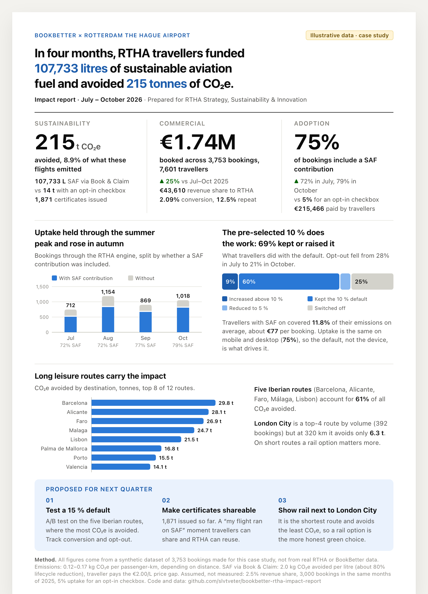

# BookBetter × RTHA: partnership impact one-pager

My answer to the case task for the Commercial Data Scientist Intern role at BookBetter (Option A): a one-page report that BookBetter could send to Rotterdam The Hague Airport, showing what the white-label booking engine has delivered in its first four months.

**All data is synthetic.** I generated it with `src/generate_data.py` and wrote down the assumptions below. What matters here is the choice of metrics, the story and the execution, not the numbers.

- [Report as HTML](https://slvtveter.github.io/bookbetter-rtha-impact-report/)
- [Report as PDF](docs/report.pdf)
- [Notebook with the pandas analysis](notebooks/analysis.ipynb)

[](docs/report.pdf)

## Why these metrics

An airport partner wants to know two things: is this engine bringing me bookings and money, and can I stand behind the sustainability claims in public?

So the page opens with one sentence an airport could quote (litres of SAF funded, tonnes of CO₂e avoided) and then shows three things: sustainability, commercial and adoption. Every headline number is shown next to a baseline, because a number alone doesn't say much:

- **SAF:** the engine pre-selects a 10 % SAF contribution. With an opt-in checkbox I assume only about 5 % of travellers would add it, which would avoid roughly 14 t instead of 215 t. This is the main point of the page: the default does the work. 69 % of travellers kept it or raised it, and opt-outs fall from month to month.
- **Bookings:** 3,753 bookings, which is 25 % more than the same four months of 2025 (assumed 3,000 through RTHA's old booking flow).

The revenue share (2.5 % of booking value, about €43.6k) is small, and I kept it on the page anyway. It is the number RTHA actually receives, and it is better to show it honestly than to hide it. I marked it as an assumption because the real contract terms aren't public.

Every assumption is printed in the footer of the page, since an airport will ask where the numbers come from.

## Headline figures (1 July – 31 October 2026)

| Metric | Value |
|---|---|
| Bookings | 3,753 (7,601 passengers), +25 % vs same months of 2025 (assumed) |
| Gross booking value | €1.74M, of which €43.6k revenue share to RTHA (2.5 %, assumed) |
| Bookings with a SAF contribution | 75 % (72 % in July, 79 % in October) |
| SAF funded | 107,733 L, €215k paid by travellers |
| CO₂e avoided | 215 t, 8.9 % of the 2,417 t emitted (opt-in baseline: about 14 t) |
| Travellers who kept or raised the 10 % default | 69 % |
| Repeat bookings | 12.5 % |
| Session-to-booking conversion | 2.09 % |

The airport-facing page leaves out the booking funnel and the device split, because they matter more to BookBetter than to RTHA. Both are in the notebook.

## How it is built

```
src/generate_data.py  ->  data/bookings.csv, data/engine_traffic.csv
src/kpis.py           ->  build/kpis.json (every number on the page)
src/charts.py         ->  SVG charts
src/build_report.py   ->  docs/index.html, docs/report.pdf, docs/report.png
src/make_notebook.py  ->  notebooks/analysis.ipynb
```

The page is rendered from `kpis.json`, so the report and the data can't disagree. Change an assumption, run `make`, and the page, PDF and notebook all update.

```bash
make setup    # virtual environment + dependencies (needs uv, Python 3.12)
make          # data, report, notebook
```

The PDF and PNG export needs Google Chrome. Without it, run `python src/build_report.py --no-pdf` to get the HTML only.

## Assumptions

| Assumption | Value | Reason |
|---|---|---|
| Emission factor | 0.17 / 0.14 / 0.12 kg CO₂e per passenger-km for under 800 / 800–1600 / over 1600 km | Short flights burn more per km. Rounded public figures. |
| SAF effect | 2.0 kg CO₂e avoided per litre | About 80 % lifecycle reduction vs about 2.5 kg per litre of fossil jet fuel |
| Traveller price | €2.00 per litre | The price gap between SAF and fossil jet fuel |
| Default | 10 % of the booking's emissions, adjustable to 0 / 5 / 20 / 30 / 50 % | Mirrors the RTHA launch set-up |
| Delivery | Book & Claim | The SAF isn't necessarily burned on the traveller's flight. The certificate says where it was supplied. |
| Revenue share | 2.5 % of booking value | Illustrative, real terms not public |
| Opt-in baseline | 5 % uptake | Assumed, to show what a checkbox without a default might achieve |
| 2025 baseline | 3,000 bookings, same four months | Assumed |
| Volumes and behaviour | about 30 bookings a day with a summer peak, 56–62 % keep the default (input values, the realised shares differ slightly) | Invented for a plausible story |

## Limits

- Everything is synthetic, and the two baselines are assumptions. With real data the first step would be to replace them with RTHA's actual 2025 bookings and a proper A/B test of default against opt-in.
- With Book & Claim, "CO₂e avoided" is an accounting claim based on certificates. It does not mean the traveller's own flight burned less fuel.
- There is no uncertainty range on the figures.

## Author

Ilia Sergeev. [LinkedIn](https://www.linkedin.com/in/sergeev-ilia-ml) · [GitHub](https://github.com/slvtveter)
