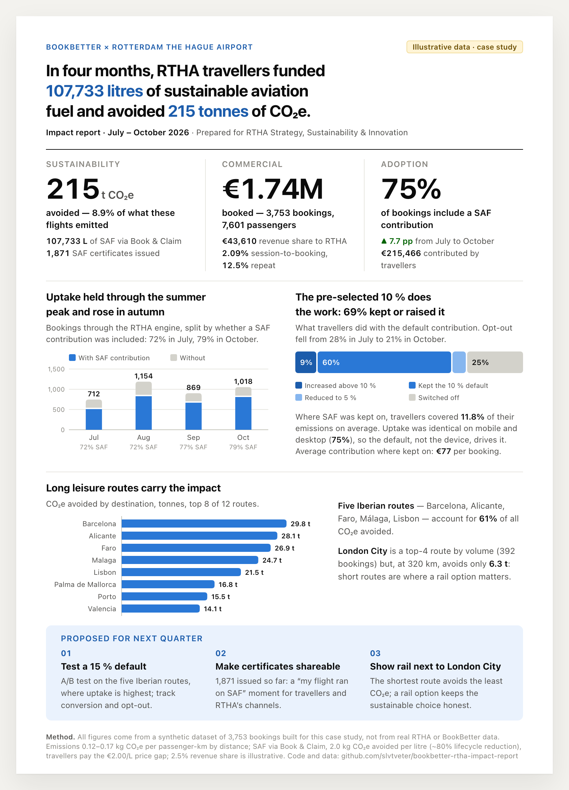

# BookBetter × RTHA — partnership impact one-pager

A one-page report that BookBetter could send to an airport partner (Rotterdam The Hague Airport)
showing the **commercial and sustainability impact** of the white-label booking engine in its first
four months. Built as a case study for the *Commercial Data Scientist Intern* role at BookBetter.

> **All data is synthetic.** The dataset is generated by `src/generate_data.py` with documented
> assumptions. The point of the exercise is the metric choice, the story and the execution — not the numbers.

**[▶ Open the report (HTML)](https://slvtveter.github.io/bookbetter-rtha-impact-report/)** ·
**[PDF](docs/report.pdf)** · **[Notebook with the pandas analysis](notebooks/analysis.ipynb)**

[](docs/report.pdf)

## Why these metrics, why this story

An airport partner has two questions: *is this engine bringing me bookings and money?* and *can I
stand behind the sustainability claims publicly?* So the page leads with one hero number an airport
can quote — tonnes of CO₂e avoided, with the honest share of total emissions next to it — and backs
it with the commercial basics (bookings, gross booking value, revenue share, conversion, repeat
travellers). The behavioural chart in the middle is the real insight: the pre-selected 10 % SAF
contribution is the product, and the page shows it works (three in four travellers keep or raise
it, opt-out falls month over month). Every claim is traceable to one dataset and one script, and
every assumption is printed on the page itself, because an airport will be asked where the numbers come from.

## How the page reads

The page is built to be understood in 30 seconds, top to bottom:

| Block | What it answers for the airport |
|---|---|
| **Headline sentence** | What this is and the result, in one line: litres of SAF funded and tonnes of CO₂e avoided |
| **Three pillars** — Sustainability · Commercial · Adoption | One big number each (215 t CO₂e, €1.74M booked, 75% kept SAF on) with two supporting figures below |
| **Uptake by month** (stacked columns) | Did the pre-selected contribution keep working after the launch effect? Share with SAF under every month |
| **What travellers did with the 10 % default** (segmented bar) | Kept / increased / reduced / switched off — the behavioural proof that the default works, plus the opt-out trend |
| **CO₂e avoided by route** (ranked bars) | Where the tonnes come from; Iberian leisure routes dominate, London City is busy but short |
| **Proposed for next quarter** | Three concrete, testable next steps |
| **Method footer** | Every assumption on the page itself, and a pointer to the code |

The booking-engine funnel (sessions → searches → bookings → bookings with SAF) and the device split are in the notebook; on the page they are reduced to the conversion rate in the Commercial pillar, because they are BookBetter's KPIs more than the airport's.

## Headline figures (synthetic, 1 July – 31 October 2026)

| Metric | Value |
|---|---|
| Bookings via the RTHA engine | 3,753 (7,601 passengers) |
| Gross booking value | €1.74M (€43.6k partner revenue share at 2.5 %) |
| SAF uptake | 75.0 % of bookings, +7.7 pp July → October |
| SAF funded | 107,733 L, €215k in traveller contributions |
| CO₂e avoided | 215 t = 8.9 % of the 2,417 t emitted |
| Repeat bookings | 12.5 % |
| Session → booking conversion | 2.09 % |

## How it is built

```
src/generate_data.py  ──▶  data/bookings.csv, data/engine_traffic.csv   (synthetic, seeded)
src/kpis.py           ──▶  build/kpis.json                                (all numbers on the page)
src/charts.py         ──▶  inline SVG charts (no charting library)
src/build_report.py   ──▶  docs/index.html  ──▶  docs/report.pdf, docs/report.png  (headless Chrome)
src/make_notebook.py  ──▶  notebooks/analysis.ipynb                       (executed pandas walk-through)
```

Everything on the page is rendered from `kpis.json`, so the report and the data cannot disagree.
Change an assumption, run `make`, and the page, the PDF and the notebook update together.

### Run it

```bash
make setup      # uv venv + dependencies (Python 3.12)
make            # data → report → notebook
# or step by step
.venv/bin/python src/generate_data.py
.venv/bin/python src/build_report.py      # add --no-pdf if Chrome is not installed
.venv/bin/python src/make_notebook.py
```

Requires Python 3.12+, [`uv`](https://docs.astral.sh/uv/) (or any venv) and Google Chrome for the PDF/PNG export.

## Data model and assumptions

`data/bookings.csv` — one row per booking: date, destination, distance, trip type, passengers,
device, customer id, gross value, CO₂e, SAF choice (`kept_default` / `increased` / `reduced` /
`switched_off`), SAF coverage %, SAF litres, contribution €, CO₂e avoided, certificate flag.
`data/engine_traffic.csv` — daily sessions, searches and bookings for the funnel.

| Assumption | Value | Why |
|---|---|---|
| Emission factor | 0.17 / 0.14 / 0.12 kg CO₂e per passenger-km for <800 / 800–1600 / >1600 km | Short hops burn more per km (take-off share); rounded public figures |
| SAF effect | 2.0 kg CO₂e avoided per litre | ≈80 % lifecycle reduction vs ≈2.5 kg CO₂e per litre of fossil jet fuel |
| Traveller price | €2.00 per litre | The price gap between SAF and fossil jet fuel |
| Default | 10 % of the booking's emissions, adjustable to 0 / 5 / 20 / 30 / 50 % | Mirrors the RTHA launch set-up |
| Delivery | Book & Claim | The SAF is not necessarily on the traveller's flight; certificates say where it was supplied |
| Partner revenue share | 2.5 % of gross booking value | Illustrative; the real contract terms are not public |
| Volumes & behaviour | ~30 bookings/day with summer peak, 56–62 % keep the default, opt-out 30 % → 22 % | Invented to make a plausible, readable story |

## Design notes

- **One sentence first.** The headline states the result; the reader knows what the page is before reading a single number.
- **Three numbers, not twelve.** Each pillar leads with one hero figure; everything else is secondary text under it.
- **Charts titled by their insight**, not by their axis names ("The pre-selected 10 % does the work", not "SAF choice distribution").
- **No dual axes, no pies, no card borders.** Sections are separated by whitespace and hairlines; the only tinted surface is the action block at the bottom.
- **Colour means one thing.** Blue = SAF / with contribution, grey = without, an ordinal blue ramp for the ordered parts of the segmented bar. Text never wears the data colour.
- **Honest marks.** Thin bars, rounded data-end only, hairline grid, 2 px gaps between stacked segments, labels only where they fit; every bar carries a hover tooltip in the HTML version.
- **Print-first.** A4 portrait, single page, Manrope, exported with headless Chrome; the HTML reflows to one column on phones.

## Repository layout

```
.
├── data/           synthetic dataset (CSV, committed so the numbers are reproducible)
├── docs/           index.html (GitHub Pages), report.pdf, report.png
├── notebooks/      analysis.ipynb — executed pandas walk-through
├── src/            generate_data.py · kpis.py · charts.py · build_report.py · template.html · make_notebook.py
├── Makefile · requirements.txt · LICENSE (MIT)
```

## Author

Ilia Sergeev — [LinkedIn](https://www.linkedin.com/in/sergeev-ilia-ml) · [GitHub](https://github.com/slvtveter)
